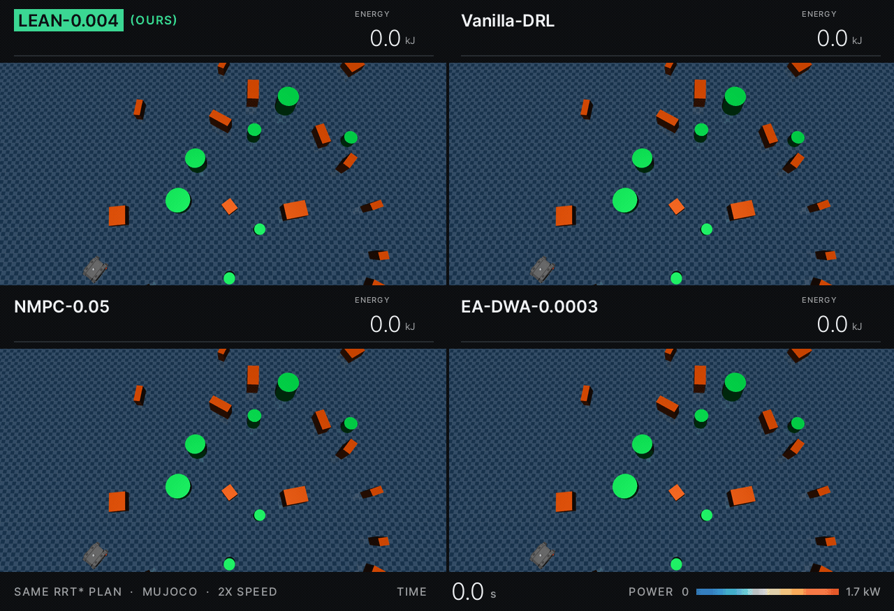
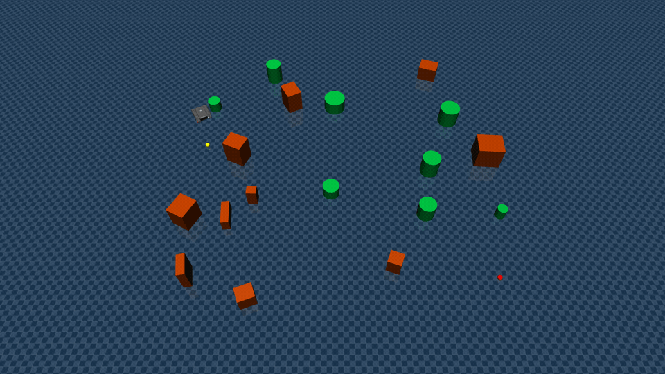

# LEAN

**LEAN: Local Energy-Aware Navigation for Skid-Steer Robots via Deep Reinforcement Learning**.

A DRL local planner policy that saves energy! 

<p align="center">
  <a href="https://ieeexplore.ieee.org/abstract/document/11743899"></a>
</p>

<p align="center">
  
</p>

## Install

```bash
conda create -n lean python=3.10.12
conda activate lean
conda env config vars set PYTHONNOUSERSITE=1 && conda activate lean
pip install torch==2.6.0 --index-url https://download.pytorch.org/whl/cu124
pip install -r requirements.txt
```

Run every command from the repository root.

## Demo

LEAN-0.004 follows a frozen RRT* path in the MuJoCo viewer:

```bash
python demo/run_demo.py
```

The viewer should look like this (2x speed the yellow dot is the look-ahead target on the frozen path, the red dot is the goal):

<p align="center">
  
</p>

## Weights

> [!TIP]
> **Recommended: LEAN-0.004, seed 300** ([download](https://github.com/octavioaguila/lean-energy-aware-navigation/raw/main/training/log/lean_we0.004_s300/best_model/best_model.zip)). Among the three
> LEAN-0.004 seeds it has the highest success rate and SPL on the hard tier (84.4%, 0.773), and on the
> hard episodes all three seeds solve it uses 804 J/m, within 0.3% of the most efficient seed of
> comparable success. It is the policy used in the hardware experiments, the demo and the GIF above.

Every run ships `best_model/best_model.zip` (the validation-EMA checkpoint) with `run_config.txt`,
`evaluations.npz` and `eval_log.txt` under `training/log/<run>/`. Hard-tier numbers come from the
global benchmark (`inference/results/global_paired/20260909_113200`, 282 hard episodes, shared frozen
RRT* plans); J/m is averaged over each run's own successful episodes.

| Model | `w_e` | Seed | Hard SR (%) | Hard J/m | Weights |
|---|---|---|---|---|---|
| Vanilla-DRL | 0 | 100 | 83.3 | 1146 | [best_model.zip](https://github.com/octavioaguila/lean-energy-aware-navigation/raw/main/training/log/vanilla_drl_s100/best_model/best_model.zip) |
| Vanilla-DRL | 0 | 200 | 71.3 | 1849 | [best_model.zip](https://github.com/octavioaguila/lean-energy-aware-navigation/raw/main/training/log/vanilla_drl_s200/best_model/best_model.zip) |
| Vanilla-DRL | 0 | 300 | 78.4 | 904 | [best_model.zip](https://github.com/octavioaguila/lean-energy-aware-navigation/raw/main/training/log/vanilla_drl_s300/best_model/best_model.zip) |
| LEAN-0.002 | 0.002 | 100 | 84.0 | 926 | [best_model.zip](https://github.com/octavioaguila/lean-energy-aware-navigation/raw/main/training/log/lean_we0.002_s100/best_model/best_model.zip) |
| LEAN-0.002 | 0.002 | 200 | 74.5 | 1048 | [best_model.zip](https://github.com/octavioaguila/lean-energy-aware-navigation/raw/main/training/log/lean_we0.002_s200/best_model/best_model.zip) |
| LEAN-0.002 | 0.002 | 300 | 83.0 | 881 | [best_model.zip](https://github.com/octavioaguila/lean-energy-aware-navigation/raw/main/training/log/lean_we0.002_s300/best_model/best_model.zip) |
| LEAN-0.003 | 0.003 | 100 | 85.1 | 883 | [best_model.zip](https://github.com/octavioaguila/lean-energy-aware-navigation/raw/main/training/log/lean_we0.003_s100/best_model/best_model.zip) |
| LEAN-0.003 | 0.003 | 200 | 82.3 | 901 | [best_model.zip](https://github.com/octavioaguila/lean-energy-aware-navigation/raw/main/training/log/lean_we0.003_s200/best_model/best_model.zip) |
| LEAN-0.003 | 0.003 | 300 | 83.0 | 852 | [best_model.zip](https://github.com/octavioaguila/lean-energy-aware-navigation/raw/main/training/log/lean_we0.003_s300/best_model/best_model.zip) |
| LEAN-0.004 | 0.004 | 100 | 83.3 | 808 | [best_model.zip](https://github.com/octavioaguila/lean-energy-aware-navigation/raw/main/training/log/lean_we0.004_s100/best_model/best_model.zip) |
| LEAN-0.004 | 0.004 | 200 | 79.4 | 793 | [best_model.zip](https://github.com/octavioaguila/lean-energy-aware-navigation/raw/main/training/log/lean_we0.004_s200/best_model/best_model.zip) |
| **LEAN-0.004** ⭐ | **0.004** | **300** | **84.4** | **829** | **[best_model.zip](https://github.com/octavioaguila/lean-energy-aware-navigation/raw/main/training/log/lean_we0.004_s300/best_model/best_model.zip)** |

The hardware experiments used `lean_we0.004_s300` and `vanilla_drl_s100`.

## Train

```bash
python training/bunker_sac.py --difficulties easy medium hard --energy-weight 0.004 --seed 100
```

## Reproduce the paper

Benchmark results are in `inference/results/global_paired/20260909_113200/` (`episodes.json`, frozen RRT* paths in `_paths/`). Classical baseline intervals come from `20260616_002825/summary.json`.

| Output | Command |
|---|---|
| Tables III, IV | `python inference/seed_stats.py inference/results/global_paired/20260909_113200` |

It writes `seed_stats.json` and `seed_stats.txt` to the run directory.

Rerun the benchmark on the same frozen paths:

```bash
mkdir -p inference/results/global_paired/rerun
cp -r inference/results/global_paired/20260909_113200/_paths inference/results/global_paired/rerun/
python inference/run_global_inference.py --output_dir inference/results/global_paired/rerun --controllers \
  vanilla_drl_s100:SAC vanilla_drl_s200:SAC vanilla_drl_s300:SAC \
  lean_we0.002_s100:SAC lean_we0.002_s200:SAC lean_we0.002_s300:SAC \
  lean_we0.003_s100:SAC lean_we0.003_s200:SAC lean_we0.003_s300:SAC \
  lean_we0.004_s100:SAC lean_we0.004_s200:SAC lean_we0.004_s300:SAC \
  NMPC:NMPC:0.0 NMPC:NMPC:0.05 NMPC:NMPC:0.1 eadwa:EADWA:0.0 eadwa:EADWA:0.0003 eadwa:EADWA:0.0005
```

`inference/freeze_paths.py` rebuilds `_paths/` from any `episodes.json`.

## Citation

If you find this work useful, please consider citing our paper:

```bibtex
@Article{AguilaRigordi2026LEAN,
  author  = {Aguila-Rigordi, Octavio and Torres-Torriti, Miguel and Toro, Rodrigo and Auat Cheein, Fernando and Araya, Mauricio},
  title   = {{LEAN}: Local Energy-Aware Navigation for Skid-Steer Robots Via Deep Reinforcement Learning},
  journal = {IEEE Robotics and Automation Letters},
  year    = {2026},
  pages   = {1--8},
  doi     = {10.1109/LRA.2026.3746160}
}
```

## License

MIT, covering the code and the released weights.
